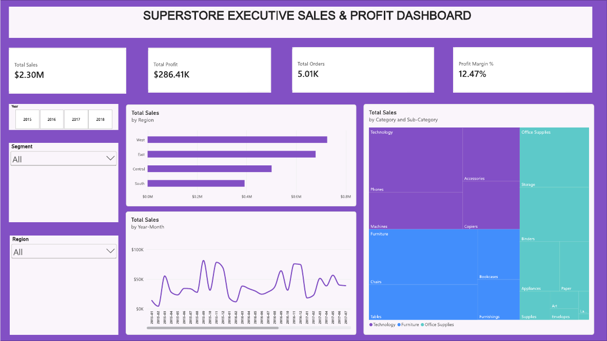

# Datheon Data Analytics & Power BI Internship

**Intern:** Promise Jeneka Taiwo
**Program:** Datheon Data Analytics & Power BI Internship (October 2026)
**Credential ID:** DT-2026-G054M

This repository holds my project work for the internship. Each task has its own folder with the code or report, the data, and a README that explains what I did and what I found.

## Projects

| Task | Project | Tools | Folder |
|---|---|---|---|
| 1 | Exploratory Data Analysis on Superstore Retail Sales | Python, Pandas, Matplotlib, Seaborn | [Task1_EDA_Superstore](./Task1_EDA_Superstore) |
| 2 | Interactive Power BI Executive Sales & Profit Dashboard | Power BI, DAX, Power Query | [Task2_PowerBI_Dashboard](./Task2_PowerBI_Dashboard) |
| 3 | Customer Cohort & Churn Analytics | Python, Pandas, Seaborn | [Task3_Churn_Analytics](./Task3_Churn_Analytics) |

## Highlights
- **Task 1:** Discounts above 20% turned orders from profitable to loss-making, and Furniture earned only a 2.5% margin.
- **Task 2:** A two-page Power BI dashboard built on a star schema, with KPI cards, slicers, a product profitability table and a discount vs margin chart.
- **Task 3:** Month-to-month customers churned at 42.7%, against 2.8% for two-year contracts.

## Dashboard preview

## Skills used
Data cleaning, exploratory data analysis, cohort and retention analysis, data modelling (star schema), DAX measures, data visualisation and business reporting.

## How to view the work
The notebooks open directly on GitHub with their charts and written findings. The Power BI file (`.pbix`) opens in Power BI Desktop on Windows. To run a notebook yourself, keep it in the same folder as its CSV and install the libraries listed in that task's README.
