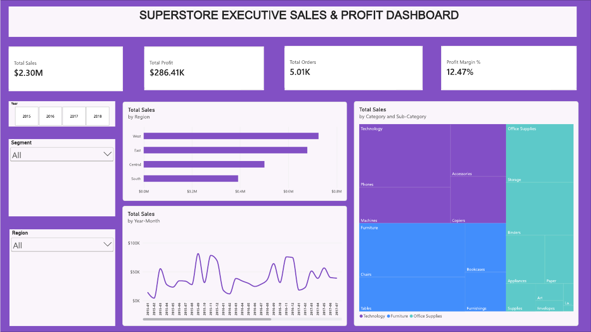
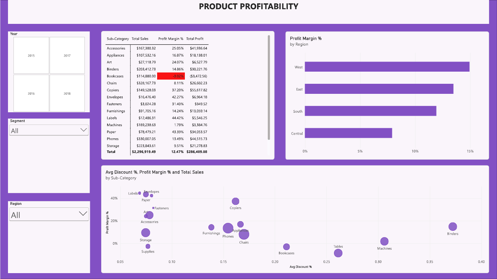

# Task 2: Interactive Power BI Executive Sales & Profit Dashboard

Datheon Data Analytics & Power BI Internship

**Author:** Promise Jeneka Taiwo

## What this project is about
I built a two-page Power BI dashboard from the cleaned Superstore sales data (the cleaning steps are in Task 1). The first page gives an executive overview of sales and profit, and the second page looks at which products make money and which ones lose it.

## Files
- `Task2_Superstore_Dashboard.pbix`: the Power BI report
- `Task2_Superstore_Dashboard.pdf`: PDF export of both pages
- `Page1_Executive_Overview.png` and `Page2_Product_Profitability.png`: screenshots
- `data/`: the cleaned tables used (`Fact_Orders.csv`, `Dim_Customer.csv`, `Dim_Product.csv`)

## Dashboard preview
### Page 1: Executive Overview

### Page 2: Product Profitability

## Tools
Power BI Desktop, DAX, Power Query

## Data model
I used a star schema. `Fact_Orders` sits in the centre and connects to `Dim_Customer` (on Customer ID), `Dim_Product` (on Product ID) and a `Dim_Date` table (on Order Date). `Dim_Date` was created with DAX and marked as the date table, with months sorted by month number.

## Key DAX measures
- Total Sales, Total Profit, Total Orders, Total Quantity
- Profit Margin % = DIVIDE ( [Total Profit], [Total Sales], 0 )
- Avg Discount %
- Sales LY and YoY Sales Growth % (using SAMEPERIODLASTYEAR)
- Return Rate %

## What the dashboard shows
**Page 1**
- KPI cards: $2.30M sales, $286.41K profit, 5.01K orders and a 12.47% profit margin
- Monthly sales trend, sales by region and a category and sub-category treemap
- Year, Segment and Region slicers that filter the whole page

**Page 2**
- A sub-category table with sales, margin and profit, with negative margins highlighted in red
- A scatter chart of average discount against profit margin, with a bubble for each sub-category
- Profit margin by region, with the same slicers

## Main insights
- Technology and Office Supplies are healthy (17.4% and 17.0% margins), but Furniture earns only about 2.5%.
- Bookcases (-3.02% margin), Tables and Supplies lose money.
- Tables (about 26% average discount), Bookcases (about 21%) and Machines (about 31%) combine heavy discounting with the weakest margins. Binders are discounted heavily too (about 37%) but still stay profitable.
- The West region has the strongest margin (about 15%) and Central the weakest (about 8%).

## How to open it
Open the `.pbix` file in Power BI Desktop (Windows). If it asks for the data, point it to the CSV files in the `data` folder.
